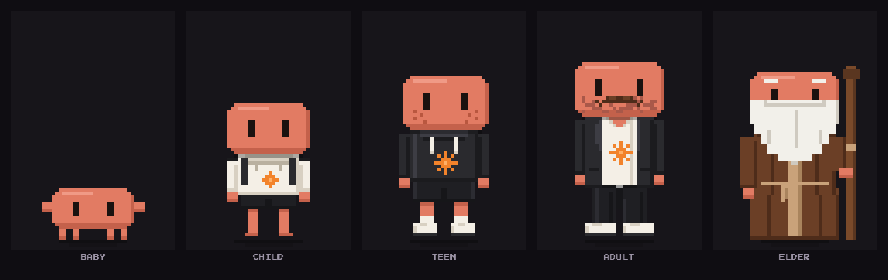
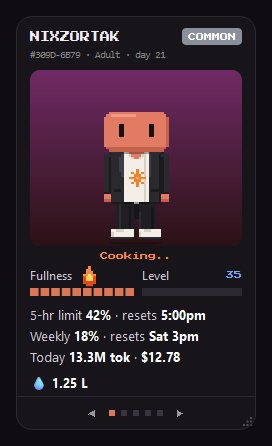
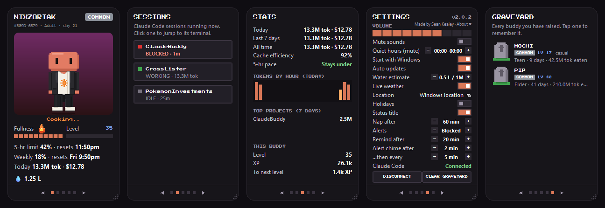
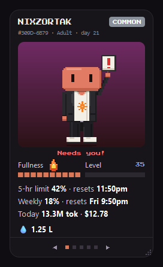
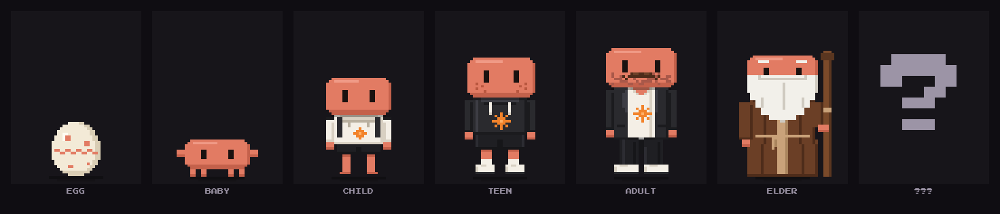

# Claude Buddy

A little pixel-art desktop pet for Windows that lives on your **Claude Code** usage. It hatches from an egg, eats the
tokens you spend, levels up through seven life stages, and gets hungry if you leave it alone for too long. Forget
about it and it starves, dies (dramatically) and moves into the graveyard, where it will be remembered forever.
Mostly by you. Mostly with guilt.

It also keeps an eye on things while you work: tokens and cost today, how much of your 5-hour and weekly limits
you've used, and a pixel "!" when a Claude Code session is waiting on you (click it to jump to that terminal).

## What you get

A small card that sits in the corner of your screen, on top of your other windows. Drag it sideways (or use the arrows
and dots) to flip between its five pages:

- **Buddy**: your pet, how full it is and its level, plus your 5-hour and weekly limits (and when they reset), today's
  tokens and cost, and a rough water estimate for the day.
- **Sessions**: every Claude Code session running right now, marked **Blocked**, **Working** or **Idle**. Click one to
  jump straight to its terminal.
- **Stats**: tokens and cost for today, the last 7 days and all time, your cache efficiency, whether you're on pace to
  stay under the 5-hour limit, tokens by hour, and your busiest projects.
- **Settings**: sounds, quiet hours, alerts and reminders, live weather on the buddy's stage, start with Windows, and
  the one-click **Connect** to Claude Code.
- **Graveyard**: every buddy you've raised, and how long it lived.

### Never miss a session that's waiting on you

When Claude Code stops to ask you something (a permission, a question, a plan to approve), your buddy holds up a
sign and the session shows as **Blocked**. Click the buddy to jump to that terminal. If you're away, a gentle chime
reminds you after a few minutes (you choose when, or turn it off).

## Your buddy

Every buddy is rolled when its egg is laid, and no two grow up quite the same:

- **Random characters and costumes.** Each egg rolls its own creature, colour and looks. Every time it evolves it
  might sprout a new hairdo, a hat or a fancy outfit. Some buddies are… rarer than others. You'll know one when you
  see it.
- **Live weather.** The stage behind your buddy shows your real local weather: sun, night, clouds, rain, snow or a
  full-on storm. Now and then the sky puts on a show: a shooting star, a rainbow after the rain, an aurora on a
  freezing night, or a lightning strike close enough to make your buddy jump.
- **Special events.** Halloween, Christmas, New Year, Valentine's, St Patrick's, Easter, the 4th of July and
  Thanksgiving dress up the stage and put a hat on your buddy, with the odd rare surprise on the day. Keep up a
  habit (late nights, marathon coding sessions, a big spending day) and your buddy picks it up too, with its own
  look until it wears off.

**Quiet hours** (23:00–08:00 by default; change them in Settings) slow hunger to a quarter, so your buddy won't
starve while you sleep. The catch: tokens spent during quiet hours earn only a quarter of the XP. Going away for a
while? Turn on **Daycare** to pause hunger, aging and XP altogether.

## Requirements

- Windows 10 or 11
- Claude Code: the CLI, or the Code tab in the Claude desktop app

## Install

1. Download `ClaudeBuddy-Setup-<version>.exe` from the
   [latest release](https://github.com/skealeye/ClaudeBuddy-releases/releases/latest).
2. Run it. No admin rights needed: it installs just for you.
3. **"Windows protected your PC"?** The installer isn't code-signed yet. Click **More info**, then **Run anyway**.
4. Your buddy appears in the corner of the screen. Open its **Settings** page (drag sideways or use the dots) and
   click **Connect** so it can see your Claude Code sessions.

## Updates

Claude Buddy keeps itself up to date: it checks once a day, downloads a new version quietly and installs it when
none of your Claude Code sessions is busy. Prefer to choose? Turn off **Auto updates** in Settings: the tray menu
then shows **Update to … available**, and **Check for updates…** looks right away. Updates are signed, and Claude
Buddy only installs updates signed by its author.

## Privacy

Claude Buddy reads Claude Code's own files on your PC and keeps everything on your PC: no account, no telemetry.
Its only network calls are the live weather (Open-Meteo, for your Windows location or a city you type) and the update
check (GitHub).

## Uninstall

Windows Settings → Apps → Installed apps → **Claude Buddy** → Uninstall. This also removes its hooks from Claude
Code. You can keep your buddy and graveyard (the default) or delete them.

## What's new

### 2.0.4

- **Start with Windows** works again. Since 2.0.0 the app could rewrite its startup entry to a file that doesn't
  exist, so it silently stopped starting with Windows. The tray's **Restart** is fixed for the same reason.

### 2.0.3

- Quiet hours now have a catch: tokens spent during them earn only a quarter of the XP.
- Settings has separate **Quiet from** and **Quiet until** rows, so you can set when quiet hours end, not just when
  they start.
- A tidier Settings page: the Water estimate and Status title rows are gone (the status title under your buddy is
  always on).

### 2.0.2

- A **Restart** item in the tray menu.
- Settings shows the game-balance number with the version, like `v2.0.2.b2`.
- Safer updates: each installer's signature is now tied to its version, and Install now always installs the newest
  release.
- Uninstalling on a PC that never ran Claude Buddy no longer leaves an empty folder behind.

### 2.0.1

The About link in Settings no longer runs into the Location row on a wide card, and the whole
line is easy to click.

### 2.0.0

The first public release: a one-click installer, automatic updates, and a buddy that lives on your Claude Code
usage.

## Support

Claude Buddy is free. If it makes your day a little better, you can
[buy me a coffee on Ko-fi](https://ko-fi.com/seankealey). ♥

Made by Sean Kealey (Digitalpirate).

---

Claude Buddy is an unofficial fan project. It is not affiliated with, endorsed by, or sponsored by Anthropic.
Claude is a trademark of Anthropic.

Weather data by [Open-Meteo.com](https://open-meteo.com/) (CC BY 4.0). Claude Buddy's licence is in
[LICENSE.txt](LICENSE.txt); the open-source components it uses are listed in
[THIRD-PARTY-NOTICES.txt](THIRD-PARTY-NOTICES.txt).
